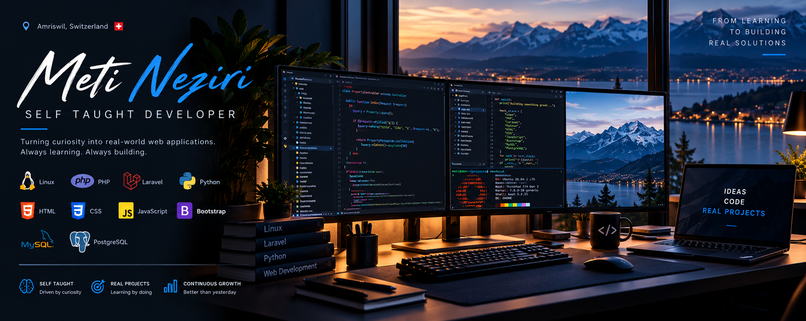

  

  # Hi, I'm Meti Neziri

  **Self-Taught Full-Stack Developer · Switzerland**

  *Learning by building. Improving with every project.*

  

    
    
    
  

---

## About Me

I'm **Meti**, a self-taught developer based in Switzerland. I built my programming knowledge independently through documentation, books, experimentation, and hands-on projects.

I work across **backend and frontend development**, with a particular interest in **PHP, Laravel, Python, and Linux**. I enjoy understanding not just *how* a feature works, but *why* a solution is structured the way it is.

My approach is simple: **learn the fundamentals, build real things, review the code, and keep improving**.

- **Backend:** PHP, Laravel, Python
- **Frontend:** HTML, CSS, JavaScript, Bootstrap
- **Databases:** MySQL, PostgreSQL
- **Development environment:** Linux, Git, GitHub
- **Growing interests:** REST APIs, software architecture, automated testing, and application security

## Tech Stack

**Backend & Programming**

**Frontend**

**Databases**

**Operating System & Tools**

## What I'm Building Toward

| Area | Current focus |
| --- | --- |
| Backend development | PHP, Laravel, Python and API fundamentals |
| Frontend development | Responsive websites with semantic HTML, CSS, JavaScript and Bootstrap |
| Database development | SQL, relational modeling, MySQL and PostgreSQL |
| Linux workflows | Command-line tools, local development and repeatable environments |
| Software engineering | Clean Code, OOP, maintainability and testing |
| Application security | Input validation, authentication, authorization and secure development |

## How I Learn

Being self-taught has shaped how I approach development:

1. **Understand the fundamentals** before relying on abstractions.
2. **Build practical projects** to turn concepts into working software.
3. **Read documentation and source code** to understand technical decisions.
4. **Refactor and test** instead of stopping when something first works.
5. **Stay curious** — there is always a better way to design, explain, or maintain a system.

## Currently Improving

- Modern PHP and Laravel application design
- Object-oriented programming, SOLID principles and design patterns
- Python scripting and automation
- SQL queries, database design and performance
- JavaScript and accessible, responsive web interfaces
- Linux tooling, Git workflows and application security

## Let's Connect

I enjoy learning from other developers, exchanging ideas, and sharing progress from my projects. If you're working with **PHP, Laravel, Python, Linux or web development**, let's connect.

  **From curiosity to code. From code to real solutions.**

  Self-taught · Based in Switzerland · Always learning

